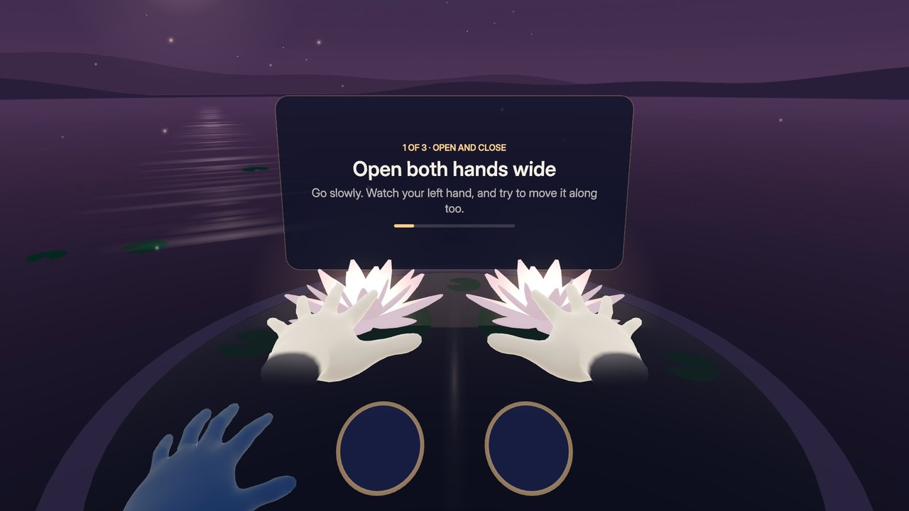

# Mirror Hand

A three-minute daily hand practice for Meta Quest and Meta VR Glasses, inspired
by mirror therapy. You move the hand that moves more easily; in the headset,
your other hand follows it like a reflection. At the end the mirror switches
off, you try the other hand on its own, and the app records how far it opened
today.

Hands only. Seated. No controllers, no account, nothing uploaded.

**Try it in Quest Browser:** https://shiv-aurora.github.io/mirror-hand/



**Not a medical device.** Mirror Hand has not been tested with patients and is
not a substitute for care from a clinician. The number it shows is an estimate
from headset hand tracking, not a clinical measurement.

## Why

Mirror therapy is an established technique in stroke rehabilitation: a person
watches the reflection of their stronger hand in a mirror placed where the
weaker hand would be, so it looks as if the weaker hand is moving. A 2018
Cochrane review (Thieme et al., 62 studies, 1,982 participants) found
moderate-quality evidence that it improves motor function after stroke, as an
addition to usual rehabilitation.

A physical mirror box only shows one flat view and needs setting up each time.
A headset can draw the reflected hand in the place where the real hand should
be, in three dimensions, and can hide the real one. This is also why Mirror
Hand is fully virtual and does not use passthrough: the illusion depends on
not seeing the hand that is not moving.

## A session

1. **Choose** — hold up the hand that moves more easily.
2. **The mirror** — that hand now drives both. Touch your hands together to begin.
3. **Open and close** — six slow open-and-close movements; two water lilies follow.
4. **Finger touches** — thumb to each fingertip in turn; each touch rings a lantern.
5. **Reach** — move both hands out to pairs of fireflies and hold.
6. **Your turn** — the mirror switches off. Open and close the other hand as far
   as is comfortable for twenty seconds.
7. **Summary** — how far that hand moved, as a share of the stronger hand's own
   range, next to your earlier sessions.

Everything adapts to the person: the range is measured against their own
stronger hand, reach targets are placed around where they first held it, and
every activity moves on by itself if a movement is not possible.

## Hand and gaze input

- All activities are done with tracked hands: opening and closing, touching
  the thumb to fingertips, and reaching.
- Buttons (Skip, Re-centre, Again, Finish) can be pressed three ways: hold an
  index fingertip on the button for about a second, point a hand ray and
  pinch, or look at the button and pinch (gaze, on Meta VR Glasses).
- Nothing requires a controller, a precise pinch, or two working hands.

## Accessibility

- Works with either hand as the stronger one, and can be finished with one hand.
- Every instruction is text on a large panel; nothing depends on hearing.
- Seated, with everything inside a small area in front of the body and inside
  the narrower field of view of Meta VR Glasses.
- No time pressure and no failure state. Activities that stall move on.
- No locomotion and no moving camera.

## Privacy

Progress is kept in the browser's local storage on the device. There is no
server, no account and no analytics.

## Built with

- [Immersive Web SDK](https://iwsdk.dev) 1.1 (three.js, WebXR, an
  entity-component system) with Vite and TypeScript
- WebXR Hand Input: 25 joints per hand, read every frame
- All sound is synthesised in the browser with the Web Audio API
- Hand meshes: the generic WebXR hand from
  [WebXR Input Profiles](https://github.com/immersive-web/webxr-input-profiles)
  (MIT licence)

### How the mirror works

When you sit down, the app records a seat frame: a point under your head,
facing the way you face. The mirror is the vertical plane through the middle
of your body in that frame. Each frame, every joint of the stronger hand is
reflected across that plane, and the reflected joints drive the mesh of the
opposite hand. The real weaker hand is not drawn until "Your turn".

## Run it locally

Requires Node 22.12 or newer.

```sh
npm install
npm run dev      # dev server with a browser-based headset emulator
npm run build    # static site in dist/
```

## Limits

- Developed and tested in the IWSDK browser emulator (Meta Quest 3 and Meta VR
  Glasses profiles). It has not yet been tested on a physical headset.
- Not tested with stroke survivors or clinicians.
- Hand tracking can lose a hand that is hidden or resting against the body.
- The evidence for mirror therapy is for the physical-mirror version alongside
  usual rehabilitation; this app has not been studied.
